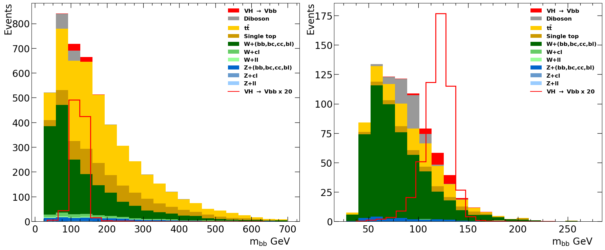
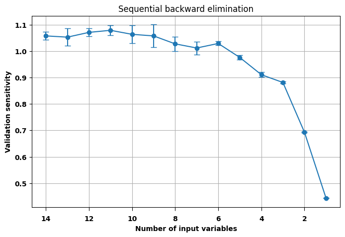
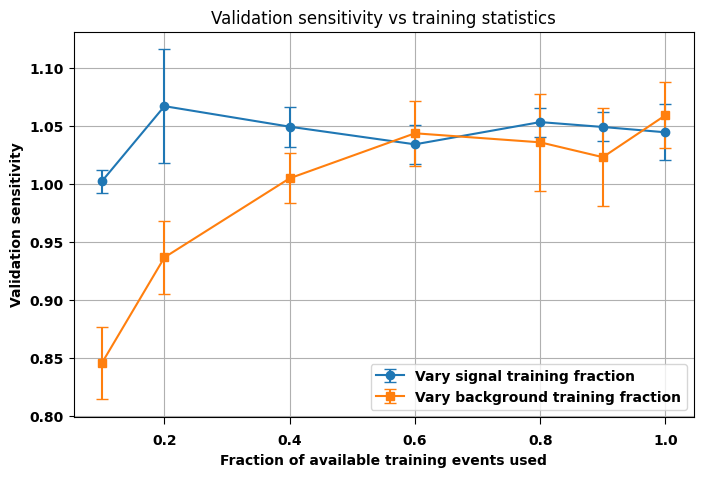
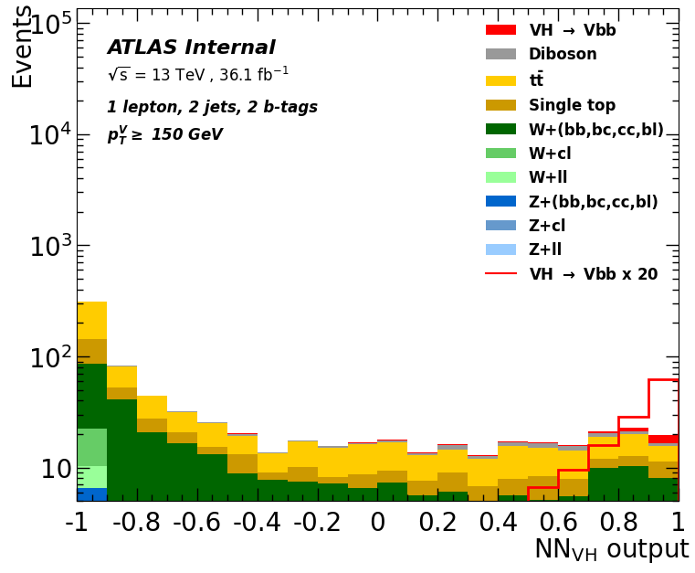
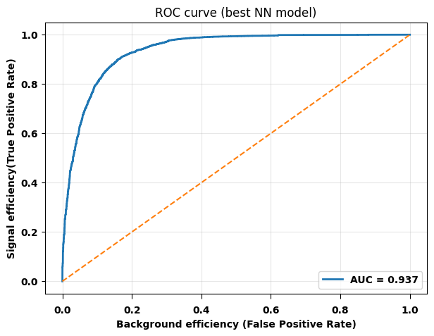

# VH(H→bb̄) Signal vs Background: Cut-Based Selection vs Neural Network

Two ways of separating the associated-production Higgs signal **VH, H→bb̄** from its backgrounds (*tt̄*, W+jets, Z+jets, single top, diboson) in simulated 13 TeV ATLAS events:

1. an **optimised sequence of rectangular cuts** (the traditional baseline)
2. a **neural network classifier** with a systematic, multi-seed hyperparameter search

Both are scored with the same figure of merit, the **expected statistical sensitivity** (profile-likelihood / Asimov significance).

> Python · TensorFlow / Keras · scikit-learn · pandas

| Selection | Expected sensitivity |
|---|---|
| No selection | 1.50 |
| Cut-based: 4 optimised cuts | 2.02 |
| **Neural network: final model, mean of 8 seeds** | **2.45 ± 0.10** |

On the test set, the neural network improves sensitivity by about **21 %** over the optimised cuts and by about **63 %** over no selection.

---

## Dataset

The dataset is simulated ATLAS events in the **1-lepton, 2-jet, 2-b-tag** channel with *p*<sub>T</sub><sup>V</sup> ≥ 150 GeV, taken from the UCL *in2HEP* teaching material. Each event has 14 kinematic and topological variables:

`nJ`, `nTags`, `dRBB`, `pTB1`, `pTB2`, `pTV`, `Mtop`, `mTW`, `MET`, `dYWH`, `dPhiVBB`, `MV1cB1_cont`, `MV1cB2_cont`, `nTrackJetsOR`

The training set contains 50,449 signal and 26,727 background events. Separate validation and test sets are used for model selection and final evaluation. The notebooks download the data and the `ucl_masterclass.py` helper module (plotting and sensitivity functions) automatically.

## 1. Cut-based selection ([`01_cut_based_selection.ipynb`](notebooks/01_cut_based_selection.ipynb))

This is a greedy, sequential cut optimisation:

1. The direction of each cut (keep > or <) is chosen by comparing signal and background distributions.
2. Each variable is scanned over 60 thresholds between its 5th and 95th percentiles, and the sensitivity of the *m*<sub>bb</sub> distribution is computed at each threshold.
3. The best single cut is applied. The scan is then repeated on the surviving events with the remaining variables, until four cuts are in place.

| Stage | Cut added | Sensitivity |
|---|---|---|
| Baseline | n/a | 1.50 |
| 1 cut | Δ*R*(b,b) < 1.37 | 1.87 |
| 2 cuts | MV1c(b₂) > 0.911 | 1.93 |
| 3 cuts | *m*<sub>top</sub> > 201.5 GeV | 1.99 |
| 4 cuts | MV1c(b₁) > 0.917 | 2.02 |

The angular separation of the two b-jets (`dRBB`) is the single most powerful variable. After the cuts, the Higgs peak near 125 GeV stands out much more clearly in *m*<sub>bb</sub>:

<p align="center">
  
</p>

## 2. Neural network ([`02_neural_network_classifier.ipynb`](notebooks/02_neural_network_classifier.ipynb))

A Keras feed-forward network is trained with event weights to output a signal probability. The sensitivity is computed from the binned NN output. Every option below was compared on **validation sensitivity averaged over 3 seeds** (with early stopping) before testing:

| Study | What was scanned | Takeaway |
|---|---|---|
| Training statistics | 10–100 % of signal / background training events | Signal statistics plateau early. Background statistics matter more. All events are used. |
| Input variables | Sequential backward elimination over the 14 inputs | Removing `dRBB` drops validation sensitivity from 1.06 to 0.66. `mTW` and `dPhiVBB` were removed. |
| Nodes per layer | (8,4,2) … (128,64,32) | Mid-sized layers performed best. |
| Hidden layers | 1–3 | Small differences, within seed-to-seed spread |
| Activation | ReLU, tanh, ELU, SELU | |
| Optimiser | Adam, SGD, RMSprop, Adagrad | Adam was best. Adagrad failed to converge well. |
| Loss | BCE, MSE, MAE | BCE was best. MAE was clearly worse. |
| Training | Learning rate × batch size grid | |

<p align="center">
  
  
</p>

**Final model:** 12 inputs, 3 hidden layers (48 → 24 → 12), ELU activation, Adam (lr = 5×10⁻⁴), batch size 64, binary cross-entropy.

The final model was retrained with **8 random seeds** and evaluated on the held-out test set:

- Test sensitivity: **2.45 ± 0.10** (range 2.30–2.61)
- Best seed: sensitivity 2.61, ROC AUC = 0.937

<p align="center">
  
  
</p>

The fully optimised model does not always beat every intermediate configuration on a single run. The per-step gains are similar in size to the seed-to-seed spread (about ±0.1), so the final number is quoted as a multi-seed mean rather than the best single run.

*Validation and test sensitivities are computed on different samples. Compare values within the same column, not across them.*

## Repository structure

```
├── notebooks/
│   ├── 01_cut_based_selection.ipynb        # sequential cut optimisation
│   └── 02_neural_network_classifier.ipynb  # NN training + hyperparameter studies
├── figures/                                # key plots exported from the notebooks
├── requirements.txt
└── README.md
```

## Running the notebooks

```bash
pip install -r requirements.txt
cd notebooks
jupyter lab
```

The first cell of each notebook downloads the CSV data into `data-v2/` and `ucl_masterclass.py` into `notebooks/` from the [in2HEP repository](https://github.com/nikitapond/in2HEP). It needs `wget`.

## Acknowledgements

Each notebook opens with a short **teaching-material** section from the UCL ATLAS / *in2HEP* masterclass (originally produced by hackingEducation). It provides the dataset, the plotting helpers and the sensitivity calculation. All of the analysis after the "Individual work" heading is my own.
